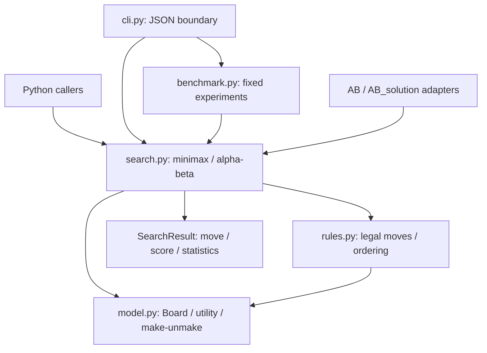

# Architecture

The package separates validated state, game rules, search, and I/O so the same
engine serves programmatic callers, command-line analysis, and benchmark runs.

## State invariants

- Each square holds at most one immutable `Piece`; positions live in the board
  dictionary rather than also being stored on each piece.
- King locations agree with occupancy, including `None` after capture.
- Cached material equals the sum of signed piece values.
- Every recursive `_push` is paired with `_pop` in a `finally` block. Search leaves
  placement, king caches, and material unchanged even when a node limit or an
  unexpected exception interrupts recursion.
- Input is copied into owned state; the public placement mapping is read-only.
  Separate `Board` instances are required for concurrent searches.

These invariants remove the need to duplicate apply/undo logic in separate
maximizing and minimizing implementations. Transition helpers are internal and
accept moves already validated by the rules layer.

## Search contract

Search depth includes the root player's move. Each visit, including the root,
increments the node count; terminal positions, depth cutoffs, and positions with
no moves increment the leaf count. A cutoff increments when alpha meets or
exceeds beta and terminates that node's loop. It counts bound-triggered loop
terminations, including one on the final available move; it does not count the
number of omitted nodes.

White maximizes and black minimizes one utility scale. Bounds start at infinity
rather than at a possible terminal score. Terminal checks precede the depth
cutoff. King-only draws precede any possible capture of the adjacent king.
Nonterminal no-move states use material utility without introducing passing.

Canonical lexicographic move order makes plain search independent of input
iteration order. Optional stable ordering tries king captures, other captures
(victim value weighted against attacker value), then quiet moves. Ties retain
canonical order within priority groups. Pruning preserves the fixed-depth
minimax value; move ordering may change which equally valued move is selected.

The node budget counts visits, including the root. A search that would visit
node `limit + 1` raises `SearchLimitExceeded`; it does not return the partially
explored root as a completed result. API callers opt into this budget; the CLI
defaults to 1,000,000 nodes. It is a node bound, not a wall-clock deadline.

## Evaluation and complexity

Material is white minus black. King absence determines a terminal score of
`WIN_SCORE - ply` or `-WIN_SCORE + ply`; a king-only draw is zero. The terminal
score dominates all possible material balances on the board. This prefers a
shorter win or a longer loss without using a probability model.

Plain minimax visits O(b^d) nodes in the worst case for branching factor `b` and
depth `d`. Alpha-beta has the same worst-case bound; effectiveness depends on
move ordering. State transitions avoid O(piece count) board copies at each
edge. Recursion keeps generated move lists, so auxiliary search storage grows
with depth and branching rather than just one board. Sorting adds overhead,
which is why measured wall time accompanies node counts.

## Compatibility and tests

`AB` and `AB_solution` export only the original public `studentAgent` and
`get_legal_moves` functions. The agent uses a five-ply white search and preserves
the historical no-move sentinel. Installation supplies these modules alongside
the package. Standalone, single-file autograder submission is outside the new
packaged interface.

The tests exercise movement against explicit expected squares, preserve the
original tactical fixtures, and compare the search value and selected action
against a copy-on-move oracle. That oracle shares the tested legal-move generator
but implements its own state copies, terminal detection, material sum, and
unpruned recursion. CLI tests run real subprocesses, including from a directory
outside the repository, and check invalid JSON, terminal results, and budget errors.
